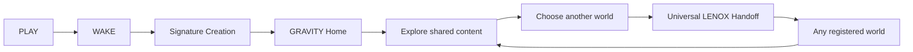
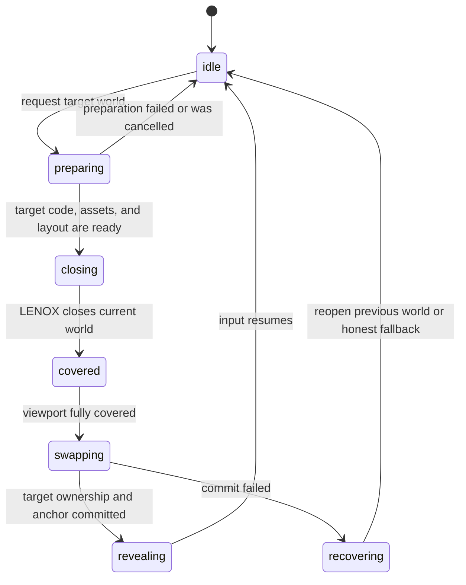

# LENOX Design Playground Architecture

**Status:** Canonical product principles; active Studio design registry
**Current focus:** `GRAVITY + LENOX`
**Creative gate:** GRAVITY creation and universal world-switch language require Volkan's approval before runtime implementation.
**Provisional until proven:** exact APIs, timing budgets, semantic section IDs, URL schema, and authored-media carrier.

## 1. Product Model

THE LENOX DESIGN PLAYGROUND is one product with one semantic content source and multiple complete website worlds.

- `GRAVITY` is LENOX's canonical home and the current signature build.
- `ATELIER`, `SIGNAL`, and later worlds remain independent website directions, not themes.
- A world may change layout, navigation, typography, motion grammar, spatial composition, content staging, and LENOX's role.
- LENOX, the content meaning, visitor inputs, locale, demo state, and semantic location persist across worlds.
- Adding a world must not require editing transitions for existing worlds.

The protected opening remains:

```text
PLAY WITH ME -> WAKE LENOX -> materialization
```

When LENOX chooses without stronger context, he opens GRAVITY. At launch, a visitor-directed path may choose another registered first world. The current build proves the GRAVITY path first.

## 2. Experience Graph

Current GRAVITY golden path:



The launch architecture also permits `WAKE -> visitor-selected first world`. There are two deliberately different transition classes.

### Signature Creation

`PLAY -> WAKE -> selected first world`

The current authored focus is `WAKE -> GRAVITY`.

- Happens once on the initial path.
- Each world that can be selected directly after WAKE may own one authored entrance sequence. This grows as `O(N)` with the number of worlds.
- May be filmic, authored, and comparatively long.
- May combine live WebGPU with Blender-authored assets, prerendered motion, AVAL, or a controlled hybrid.
- Preserves canonical LENOX identity, state continuity, accessible fallback, and a precise handoff into the live page. The live vessel may temporarily hand off visually to authored media when the seam is exact.
- Current creative work defines the final visual contract; technique follows the approved visual result.

### Universal World Switch

`ANY WORLD -> neutral LENOX moment -> ANY WORLD`

- Short, repeatable, source-target-independent, and safe at any semantic section.
- Feels like an intentional cut rather than a second spectacle. Exact normal and Reduced Motion timing are set by prototype evidence.
- Uses one universal close/cover action, one hidden atomic swap, and a brief target-specific reveal.
- Requires no bespoke pair transition such as `GRAVITY -> ATELIER` or `SIGNAL -> GRAVITY`.

For `N` worlds, transition authoring therefore grows as `O(N)`, not `O(N²)`.

The visual cover may become a blink, eclipse, blackout, collapse to void, or another approved LENOX action. The architecture depends only on complete temporary coverage, not on a particular effect.
It is authored as an intentional action by LENOX, never presented as a loading screen.

## 3. Universal Switch Transaction



Before closing:

1. Capture the active semantic section, local progress, focus intent, and session state.
2. Load the target renderer, required assets, and fonts while the current world remains visible.
3. Stage an inert target layout when the device budget permits, so it can be measured before the cover begins.
4. Commit one active switch transaction and suspend the current world's side effects at the handoff point.

Only while fully covered:

1. Deactivate the old interactive world and activate the prepared target.
2. Apply the target scene and LENOX stage profiles to the existing engine.
3. Restore the semantic anchor and equivalent focus intent.
4. Commit URL/history state only after the target world owns the experience successfully.

The cover never waits on network loading or font discovery. It conceals only the atomic ownership change.

On reveal:

1. Run the target world's brief reveal accent.
2. Resume demo timing, scroll ownership, and input.
3. Restore keyboard focus and announce the world change accessibly.

The swap is transactional. If the target fails, the previous world reopens or the honest reduced experience appears; the URL must not claim a world that did not mount.

## 4. Runtime Ownership

### `src/flow-engine/`

Owns:

- the only WebGPU renderer and render loop;
- simulation, particles, materials, lighting, camera integration, and LENOX vessel;
- continuous pointer, gaze, camera, particle, and reconstruction values;
- applying world and LENOX stage profiles without recreating the engine.

### React stage and future playground modules

Own:

- discrete product state and valid state transitions;
- the single world-switch transaction coordinator;
- shared semantic content and DE/EN locale data;
- active world configuration and URL state;
- semantic anchors, accessibility, focus, and orchestration commands;
- the single active DOM world renderer.

React does not own per-frame motion values. Refs, GSAP/ScrollTrigger, and the engine carry continuous values without forcing React renders.

## 5. Design Contract

GRAVITY REEF and SIGNAL EDITORIAL now provide the two launch implementations needed to formalize the active seam. `src/app/studio/designRegistry.ts` is the single Studio source for valid design IDs and design-specific runtime behavior.

```ts
const STUDIO_DESIGNS = {
  reef: {
    label: "GRAVITY REEF",
    shortLabel: "REEF",
    rendererClass: "reefRenderer",
    worldMedia: "film",
    lenoxPresence: "full",
    engineSignature: null,
  },
  signal: {
    label: "SIGNAL EDITORIAL",
    shortLabel: "SIGNAL",
    rendererClass: "signalRenderer",
    worldMedia: "none",
    lenoxPresence: "recessed",
    engineSignature: null,
  },
} as const;

type DesignId = keyof typeof STUDIO_DESIGNS;
type DesignDefinition = (typeof STUDIO_DESIGNS)[DesignId];
```

The active entry declares four current axes:

- DOM composition through its registered renderer class;
- world-media behavior;
- LENOX presence over the composition;
- an optional engine signature hook.

The definition may grow with a lazy renderer module, asset manifest, LENOX stage profile or reveal accent when a real added design requires those capabilities. Those additions belong on the registry entry, not in design-name conditionals across the runtime.

Semantic continuity remains independent of design:

```ts
type SemanticAnchor = {
  sectionId: ChapterId;
  progress: number;
};
```

Shared content is injected into the renderer; it is not duplicated inside each world definition.

Every new world provides:

- one renderer over shared content;
- one engine scene profile;
- one LENOX stage profile;
- curated palette and typography presets;
- one authored initial-creation route when that world is directly selectable after WAKE;
- one brief reveal accent and an anchor resolver.

It provides no transitions to other worlds.

Inactive renderer code may be prefetched, but only one world is interactively mounted after the covered swap. The WebGPU engine is never duplicated or restarted for a normal world switch.

## 6. Shared Content and Continuity

The architecture requires one ordered semantic manifest with stable IDs. Public section names and the final spine remain a product decision. The current runtime still uses historical regions such as `experience`, `systems`, `work`, `volkan`, and `contact`; worlds reference semantic IDs rather than visible labels.

- German and English are complete canonical locales. German follows Swiss `ss` orthography.
- Worlds may regroup and dramatize content while preserving required product truths and approved claims.
- Cases, guided demos, qualification, and contact use structured data rather than renderer-specific copy.
- Shareable URL state records at least world, locale, and semantic section. Palette, typography, and motion enter the URL only when intentionally shareable.
- A switch preserves `sectionId + local progress`, not exact pixels.
- Demo step, form values, locale, and user choices remain session state outside the world renderer.

## 7. GRAVITY Architecture

GRAVITY is a permanent living environment behind and around a vertically scrolling website.

- The WebGPU canvas remains fixed and continuous.
- One scroll container and one director are authoritative for the journey.
- DOM chapters, LENOX pose, camera, lighting, and environment response derive from that scroll progression.
- LENOX belongs to the world and causes its responses; he does not float beside a conventional website.
- The Wallow reference contributes the living-background-plus-scroll principle, not its bath imagery, typography, cards, or surface styling.
- Desktop and mobile share semantic chapters but receive separately authored composition, pacing, LENOX staging, and readable content zones.
- Mobile keeps vertical journey scroll authoritative and never lets a horizontal instrument capture it.

The first technical slice after creative approval proved:

```text
PLAY -> WAKE -> GRAVITY creation -> one complete scrolling act
```

The active Studio build now includes SIGNAL and the broad registry seam. Later designs extend that registry without adding pair-specific transitions.

## 8. Live Runtime vs Authored Media

Live runtime owns the identity and continuity of the experience:

- pointer and touch response;
- LENOX state, gaze, material, and staging;
- scroll-linked camera and environment behavior;
- semantic state, focus, accessibility, and fallbacks.

Authored media may support Signature Creation when it provides a visual result the live engine cannot reach efficiently. A directly selectable world may own one WAKE entrance asset or route. The media enters and leaves on an exact camera, material, and LENOX-state boundary, remains subordinate to product state, and includes a reduced-motion path.

AVAL, Blender output, transparent video, and live WebGPU are candidate carriers rather than architectural dependencies.

The frequent Universal World Switch remains live and lightweight. It functions without pair-specific video; an optional universal authored micro-layer is acceptable only when the same route works across worlds and the fallback remains complete.

## 9. Resilience and Accessibility

- `prefers-reduced-motion` overrides selected motion intensity.
- Reduced Motion preserves all content and semantic continuity without long camera or particle beats.
- WebGPU initialization failure produces an honest reduced experience, not false parity.
- Device-loss recovery may attempt one controlled engine restart while retaining world config, anchor, locale, and session state.
- Keyboard focus returns to the equivalent semantic element or world instrument after a switch.
- Controls remain at least `44 px`, contrast meets WCAG AA, and world changes use restrained live-region status.
- Audio starts only after an explicit visitor action and never carries essential meaning alone.
- Simulated actions stay labelled; amber appears only after a real confirmed action.

## 10. Reuse and Migration Boundary

Reuse:

- protected PLAY/WAKE state flow and valid reducer transitions;
- one engine bridge, renderer, simulation, and authoritative transition clock/progress source;
- responsive `side` / `banded` composition boundary;
- one Journey scroller, station model, director, and engine pose bridge;
- deterministic case timing and honest non-delivery behavior;
- existing i18n messages as content-source material.

Migrate or retire after parity:

- `LenoxSignatureId = "obsidian" | "alabaster"` and pair-specific selection;
- signature-specific DOM tokens, material presets, and calibration copy;
- current EXPERIENCE plates, SYSTEMS strata, WORK staging, and station camera art direction;
- legacy Source Chamber positioning and unfinished VOLKAN branch;
- facial acting or mobile compositions that conflict with the approved GRAVITY contract.

## 11. Creative and Engineering Workflow

```text
VOLKAN -> FABLE IN CLAUDE CODE -> CODEX -> BROWSER EVIDENCE -> VOLKAN
```

- **Volkan:** vision, trade-offs, and final visual acceptance.
- **Fable in Claude Code:** visual direction, motion concepts, LENOX behavior, storyboard, and concise Creative Contract.
- **Codex:** feasibility pressure-test, architecture, implementation, debugging, and browser verification after concept approval.
- **Fresh reviewer when useful:** independent acceptance, never a concurrent writer.

Claude Code is the orchestration host; Fable is the Claude model operating inside it. Only one agent writes to the working tree at a time.

### Fable / Codex collaboration protocol

- Fable first reads `CLAUDE.md`, `CURRENT.md`, `TASK.md`, this architecture, and the available visual evidence, then produces its own synthesis before delegating.
- Before Volkan approves the Creative Contract, Codex participation is manual and read-only: feasibility analysis, repository archaeology, risk discovery, or adversarial technical review.
- The automatic Codex review gate remains disabled.
- The repository default for principal technical work is `gpt-5.6-sol` with `high` reasoning, as configured in `.codex/config.toml`.
- After approval, Fable hands Codex one explicit outcome-led implementation task or transfers the approved context. Codex then becomes the sole runtime writer for that task.
- A secondary Codex model may handle bounded support or an independent review after its exact local model ID is confirmed. It does not write concurrently with Sol.

Handoffs stay compact and outcome-led:

```text
GOAL
WHY
CURRENT REALITY
VISIBLE DONE WHEN
```

The handoff specifies the visible payoff, scope boundary, and evidence gate while leaving implementation choices to the responsible specialist.

## 12. Approval Sequence

1. Fable ingests the canonical documents, current repository reality, and visual evidence, then records its own understanding and tensions.
2. Fable explores a small set of genuinely different Signature Creation and Universal Switch concepts, typically three of each.
3. Codex `gpt-5.6-sol` performs a manual read-only feasibility pressure-test of Fable's strongest candidates.
4. Fable synthesizes the recommendation with desktop/mobile storyboards and a live-versus-authored boundary.
5. Volkan approves or refines the Creative Contract.
6. Codex builds the narrow `WAKE -> GRAVITY -> one complete scrolling act` runtime slice.
7. Desktop, mobile, Reduced Motion, fallback, console, performance, and real motion recordings are reviewed.
8. The covered-swap transaction and registry are now active with GRAVITY REEF and SIGNAL EDITORIAL. Additional designs must enter through that same contract.
9. GRAVITY expands only after the visible slice establishes the quality bar.
10. New designs may extend the contract only from concrete requirements; they must not reintroduce binary state, pair-specific transitions or duplicated content.

Build success is necessary; browser and video evidence plus Volkan's visual acceptance decide whether the experience is actually approved.
