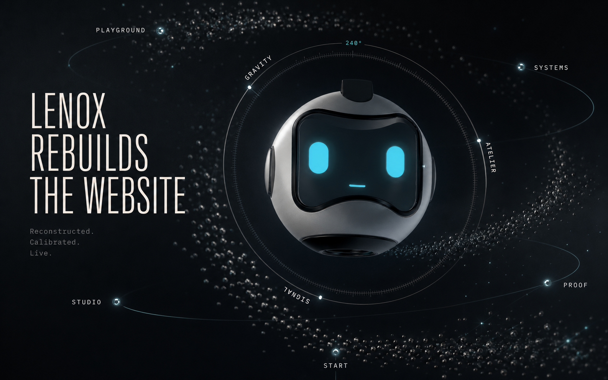
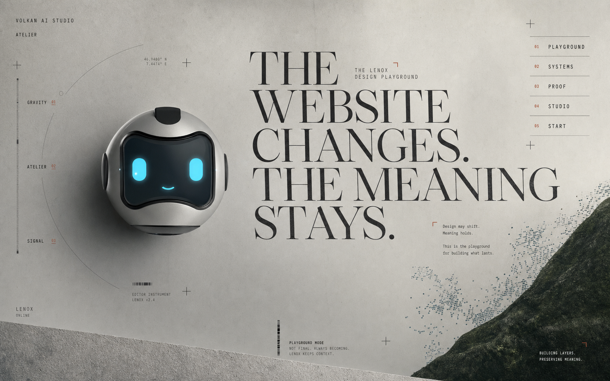
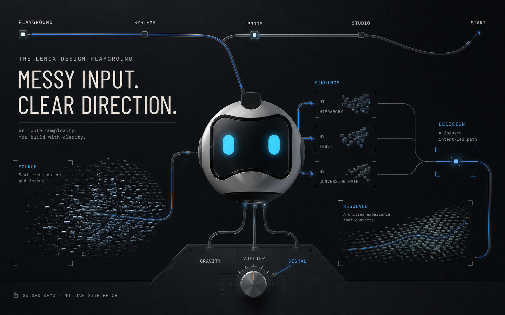

# LENOX Design Playground Visual Gate

Status: `HISTORICAL CANDIDATE SET — NOT THE ACTIVE GATE`

These three desktop frames record an earlier attempt to establish all launch directions at once. They remain useful references for contrast, composition, LENOX staging, and design-range discussion, but they are not approved targets and no longer block focused GRAVITY work.

The current active direction is GRAVITY + LENOX. ATELIER and SIGNAL are deferred until GRAVITY establishes the signature quality bar. See `docs/agent-system/CURRENT.md` and `docs/agent-system/TASK.md`.

## 1. GRAVITY

Target read:

- LENOX is the gravitational centre and remains the dominant object.
- Navigation is spatial and orbital instead of a conventional header.
- The website feels pulled into one continuous dark chamber rather than arranged as sections or cards.
- Cyan remains coupled to LENOX and his immediate field.

Review risk:

- The generated vessel is recognisable but not asset-faithful enough for production.
- The final design must use the real runtime sphere and avoid the enlarged face-panel interpretation.

## 2. ATELIER

Target read:

- The same product becomes a light, asymmetrical editorial world.
- LENOX acts as a physical editor in the margin rather than a floating mascot.
- The living index, type scale, texture, and crop grammar replace the dark spatial language.
- The canvas avoids the current stacked-paper composition and a generic beige SaaS read.

Review risk:

- The generated smile conflicts with the restrained LENOX acting rule and must not survive implementation.
- Texture and editorial marks need reduction before production so that structure remains primary.

## 3. SIGNAL

Target read:

- LENOX is the visible routing core between source, three findings, decision, and resolved result.
- Navigation is a topological journey path rather than a header, sidebar, or dashboard tab set.
- Information is carried by routes and spatial states, not KPI cards.
- Template ultramarine remains distinguishable from LENOX cyan.

Review risk:

- The lower hardware-console treatment is too literal and must become part of LENOX rather than a separate control desk.
- The final guided demo must use real VOLKAN-owned source screenshots, not generated interface imagery.

## Historical Decision

The three desktop directions were different enough to prove that the product thesis could support real visual range, but they did not receive human approval and are not production targets.

The former requirement to complete mobile, PROOF, reconstruction, and storyboard boards for all three directions before any runtime work is superseded.

Current gate:
- define GRAVITY as LENOX's living home on desktop and mobile;
- approve the authored `WAKE -> GRAVITY` creation concept;
- approve one universal, source-target-independent later world-switch concept;
- then build a narrow GRAVITY runtime slice before returning to ATELIER or SIGNAL.
